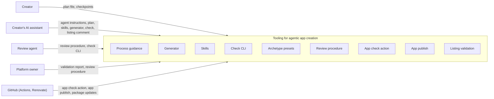

# System Scope and Context

The system is the tooling for building, validating and listing apps: process guidance, generator and archetype
presets, skills, checks, the review and the validation report. Most of it is one package in lernapps/tooling. The
archetype templates live in lernapps/app-templates and the listing validation in lernapps/apps (chapter 5).

Outside the system are the people and assistants who use it, GitHub where it runs, and the parts of lernapps.net it
depends on but does not own. The shared site frame gives pages on lernapps.net their header, footer and site check.
The entry schema belongs to lernapps/apps. Apps are hosted where their developers choose, by default on the GitHub
Pages of their own repo.

The tooling's repo also serves the lernapps.net sites, which are not apps: it holds the actions that check, publish
and preview a site (chapter 5, "Site actions") and the shared update policy of every lernapps repo. Neither is part of
the app path.

## Context overview

```arc42
:::diagram
id: context-overview
view: context
notation: mermaid
:::
```



## Creator

A teacher, parent or student who builds an app for a gap they noticed ([app creators](https://lernapps.net/docs/platform-design/#1-exploration/e2-scan.pdt42.md:el-e-creators)). They talk to their assistant,
read the plan and confirm it. After that, they are asked only at the checkpoints. They never need to know the rules
or the toolchain.

```arc42
:::actor
id: actor-creator
title: Creator
type: person
description: Builds an app with their AI assistant; reads and confirms the plan
requires: if-plan-file
:::
```

## Creator's AI assistant

Claude Code, Codex, Gemini CLI or another agent, chosen by the creator ([AI assistants](https://lernapps.net/docs/platform-design/#1-exploration/e2-scan.pdt42.md:el-e-ai-assistants)). It reads the agent
instructions, writes the plan, creates the app, follows the skills, reacts to the checks and fills the entry. It is a
partner the platform designs for, not part of the system.

```arc42
:::actor
id: actor-assistant
title: Creator's AI assistant
type: system
description: Any coding agent; works from plain files and CLIs, no MCP server required
requires: if-agents-md, if-plan-file, if-generator-cli, if-skills, if-check-cli, if-listing-comment
:::
```

## Platform owner

Decides whether an app is listed, maintains the rules and runs the review and the evals (one owner,
`con-one-owner`). Reads the validation report and the retrospective.

```arc42
:::actor
id: actor-owner
title: Platform owner
type: person
description: Decides listing, maintains the rules, runs review and evals
requires: if-validation-report, if-review-procedure
:::
```

## Review agent

An agent in a fresh context, run by the owner. It follows the review procedure,
starts from the check CLI's report and judges what the checks cannot decide.

```arc42
:::actor
id: actor-review-agent
title: Review agent
type: system
description: Fresh-context agent that validates an app before listing
requires: if-review-procedure, if-check-cli, if-validation-report
:::
```

## GitHub

Runs the checks of every app repo and the listing validation in lernapps/apps, serves an app from its own repo by
default, and proposes every update of the tooling to every app.

```arc42
:::actor
id: actor-github
title: GitHub (Actions, Pages, Renovate)
type: system
description: Runs CI and the listing validation, serves an app from its repo's Pages by default; Renovate bumps the tooling package in every app
requires: if-app-check-action, if-app-publish, if-archetype-preset
:::
```
