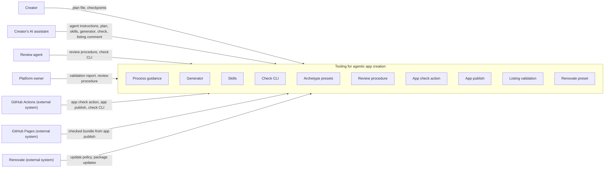

# System Scope and Context

The system is the tooling for building, validating and listing apps: process guidance, generator and archetype
presets, skills, checks, the review and the validation report. Most of it is one package in lernapps/tooling. The
archetype templates live in lernapps/app-templates and the listing validation in lernapps/apps (chapter 5).

Outside the system are the parties who use it, the external systems it runs on, and the parts of lernapps.net it
depends on but does not own. The parties have intentions: the creator, their assistant, the owner and the review
agent. The external systems only do what they are configured to do: GitHub Actions, GitHub Pages and Renovate. The
DSL models both as actors; the external systems have the type system. The shared site frame gives pages on lernapps.net their header, footer and site check.
The entry schema belongs to lernapps/apps. Apps are hosted where their developers choose: by default on the GitHub
Pages of the developer's own repo, at the developer's address, or on any other host. Only an app whose repo belongs to
the lernapps organisation is served below lernapps.net.

The tooling's repo also holds "Platform upkeep" (chapter 5): the build of the tooling's own docs, the actions for
lernapps.net's own websites and the update policy of every lernapps repo. No creator uses it, and it is not part of
the app path.

## Context overview

```arc42
:::diagram
id: context-overview
view: context
notation: mermaid
:::
```



## Creator

A teacher, parent or student who builds an app for a gap they noticed ([app creators](https://lernapps.net/docs/platform-design/#1-exploration/e2-scan.pdt42.md:el-e-creators)). They talk to their assistant,
read the plan and confirm it. After that, they are asked only at the checkpoints. They never need to know the rules
or the toolchain.

```arc42
:::actor
id: actor-creator
title: Creator
type: person
description: Builds an app with their AI assistant; reads and confirms the plan
requires: if-plan-file
:::
```

## Creator's AI assistant

Claude Code, Codex, Gemini CLI or another agent, chosen by the creator ([AI assistants](https://lernapps.net/docs/platform-design/#1-exploration/e2-scan.pdt42.md:el-e-ai-assistants)). It reads the agent
instructions, writes the plan, creates the app, follows the skills, reacts to the checks and fills the entry. It is a
partner the platform designs for, not part of the system.

```arc42
:::actor
id: actor-assistant
title: Creator's AI assistant
type: system
description: Any coding agent; works from plain files and CLIs, no MCP server required
requires: if-agents-md, if-plan-file, if-generator-cli, if-skills, if-check-cli, if-listing-comment
:::
```

## Platform owner

Decides whether an app is listed, maintains the rules and runs the review and the evals (one owner,
`con-one-owner`). Reads the validation report and the retrospective.

```arc42
:::actor
id: actor-owner
title: Platform owner
type: person
description: Decides listing, maintains the rules, runs review and evals
requires: if-validation-report, if-review-procedure
:::
```

## Review agent

An agent in a fresh context, run by the owner. It follows the review procedure,
starts from the check CLI's report and judges what the checks cannot decide.

```arc42
:::actor
id: actor-review-agent
title: Review agent
type: system
description: Fresh-context agent that validates an app before listing
requires: if-review-procedure, if-check-cli, if-validation-report
:::
```

## GitHub Actions

An external system. It runs the checks and the publishing in the developer's app repo, with the app check action
and the app publish action, and the listing validation in lernapps/apps, with the check CLI.

```arc42
:::actor
id: actor-github-actions
title: GitHub Actions
type: system
description: External system; runs the app check and app publish actions in the developer's app repo and the listing validation in lernapps/apps
requires: if-app-check-action, if-app-publish, if-check-cli
:::
```

## GitHub Pages

An external system: the default hosting of an app, and optional. It serves the checked bundle that the app publish
action puts in the developer's repo, at the developer's own address. A developer may use any other host instead.

```arc42
:::actor
id: actor-github-pages
title: GitHub Pages
type: system
description: External system; the default and optional hosting of an app, at the developer's own address
requires: if-app-publish
:::
```

## Renovate

An external system. It reads the shared update policy and proposes every new version of the tooling package, the
runtime and the actions to every repo, as update pull requests.

```arc42
:::actor
id: actor-renovate
title: Renovate
type: system
description: External system; applies the update policy and proposes updates of the tooling package to every app
requires: if-update-policy, if-archetype-preset
:::
```
