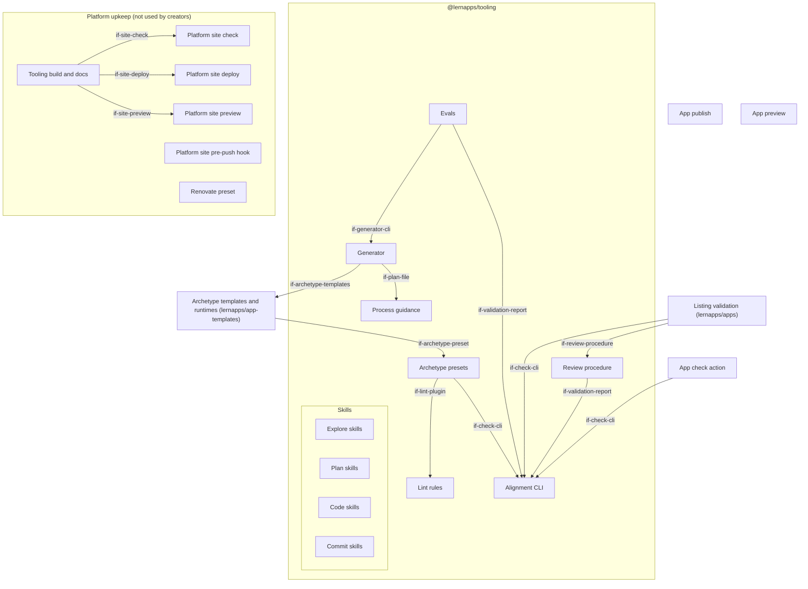
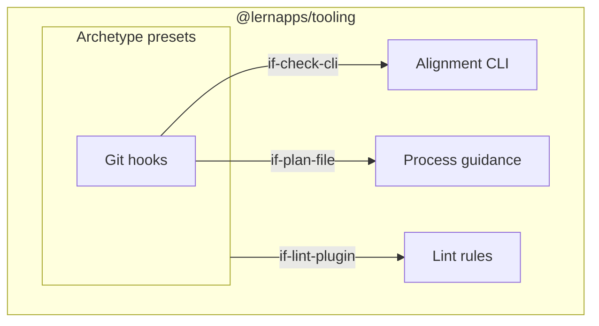
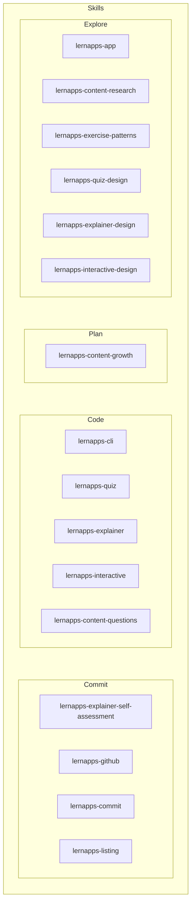

# Building Blocks

The tooling is one package, installed by apps from git at a commit and kept current by update pull requests, like
the shared site frame (decision `dec-one-package`). Next to the package, the repo holds three actions for an app's CI:
one checks the app, one publishes it, one previews a pull request. Two blocks live in other repos: the archetype templates and runtimes, and the
listing validation in the catalog. All of these make up the creator's path.

The repo also holds "Platform upkeep", which no creator uses: it builds and documents the tooling itself, checks and
publishes lernapps.net's own websites, and sets the update policy of every lernapps repo. A site, in this document,
is always one of lernapps.net's own websites, never an app.

Rules have no block of their own: each rule lives in the block where it acts, as skill text, lint rule, check or
rubric item (concept `concept-rule-catalog`).

The blocks and interfaces a creator and their assistant work with carry the phases of the plan they support and what
each does for the assistant and the person (`x-phase`, `x-agent`, `x-person`). The docs page "A workshop, not a
factory" is rendered from them, with their technology or protocol.

## Level 1

```arc42
:::diagram
id: building-blocks-level-1
view: building-block
notation: mermaid
:::
```



## Level 2: archetype presets

```arc42
:::diagram
id: building-blocks-archetypes
view: building-block
notation: mermaid
roots: bb-archetypes
:::
```



## Level 2: skills by phase

```arc42
:::diagram
id: building-blocks-skills
view: building-block
notation: mermaid
roots: bb-skills
:::
```



## @lernapps/tooling

The one package every app depends on. It is accountable for carrying every rule, check and piece of guidance to every
app, so that an app never has to be edited to receive a change. An app holds only thin files that refer to it. The
package checks itself with the same command it gives apps, plus a test that rule ids are unique and every message
links its rule.

```arc42
:::building-block
id: bb-tooling-package
title: "@lernapps/tooling"
technology: TypeScript, npm package from git
implements: concept-stable-contracts
:::
```

### Process guidance

The workflow for the creator's assistant: four phases, Explore, Plan, Code and Commit, with the creator's
checkpoints. It decides the order of the work, when the assistant stops for the creator, and which skill it loads in
which phase. It is the only guidance that holds in every phase: the entry `llms.txt` of the tooling site, which
starts the build with the plan template and nothing else, `AGENTS.md`, the two plan templates, the workflow rules
with their ids, and the brief for sub-agents.

The plan starts with the questions for the creator, including what the catalog needs to help adults find the app,
and keeps the answers for the listing. It ends with a retrospective: phases reached, the creator's turns after the
plan, and where the assistant had to guess; the failed checks the check itself counts in the front matter. Comments
in the template explain each part, so the template itself guides the assistant. Commands, rules and know-how are in
the skills it names.

```arc42
:::building-block
id: bb-process-guidance
title: Process guidance
parent: bb-tooling-package
technology: Markdown
implements: concept-plain-language, concept-terse-output, concept-traceability, concept-rule-catalog
x-phase: across
x-agent: Gives the four phases, the checkpoints, and which skill comes when; a brief for each sub-agent.
x-person: Answers the interview and confirms at each checkpoint.
:::
```

#### AGENTS.md

The entry point every assistant reads in the app repo, on every return. A consumer can rely on it to stay short and
to point to the current plan and the templates; it holds nothing else.

```arc42
:::interface
id: if-agents-md
title: AGENTS.md
provider: bb-process-guidance
protocol: Markdown file at the app's root
x-phase: across
x-agent: Reads it on every return: where the current plan is and what holds.
:::
```

#### Plan file

The plans in the app repo, one per piece of work, readable by the creator: the first version's and one for each later
increment, numbered. The one with the highest number is the current plan; the hooks count in it and the checks read
its phase, and the others are its record. An older app's single plan counts as the first until the update moves it.
They stay in the creator's repo and reach the platform only with a listing. A consumer can rely on two things: its front matter has a versioned schema, and its headings, the four
phases and the parts of the retrospective, are fixed. Hooks, review and evals read it by those. A breaking change gets
a new schema version.

```arc42
:::interface
id: if-plan-file
title: Plan file
provider: bb-process-guidance
protocol: Markdown with YAML front matter and a versioned JSON Schema
x-phase: across
x-agent: Works the plan step by step and notes where it had to guess.
x-person: Reads where the work stands, in plain words.
:::
```

### Skills

What the assistant needs to know in one phase, and the rules of that phase, each with its id. Every skill is a block
of its own with one goal, and belongs to exactly one phase; its description says first when it is needed, so a harness
offers it at that moment. A skill too long to load at once keeps its `SKILL.md` short and links files in its
`references/`, each with the moment to read it. On disk the skills are grouped by what they hold
(`skills/<process|tooling|content|archetypes>/<name>/`), which says who changes them: the process, the CLI, the
know-how of content, or an archetype's template. They are installed flat (`.agents/skills/<name>/`): all but the
archetypes' at the start of the plan, the two of the chosen archetype when Explore chooses it. The skills reach the
creator's agent harness for an app from the generator as for one built otherwise.

```arc42
:::building-block
id: bb-skills
title: Skills
parent: bb-tooling-package
technology: Markdown (agentskills.io)
implements: concept-rule-catalog, concept-plain-language, concept-terse-output
:::
```

#### Explore skills

The skills that find out what the app teaches, how learners practise it and which archetype fits, before anything is planned or built.

```arc42
:::ignore W002 a group of skills; the contract is the skills interface :::
:::building-block
id: bb-skills-explore
title: Explore skills
parent: bb-skills
technology: Markdown (agentskills.io)
:::
```

##### lernapps-app

Goal: The assistant knows what every app on lernapps.net must be and chooses the archetype from what learners do, after reading what each archetype can and cannot do in the README of its template.

```arc42
:::ignore W002 a part of the skills; the contract is the skills interface :::
:::building-block
id: bb-skill-app
title: lernapps-app
parent: bb-skills-explore
path: skills/process/lernapps-app
technology: Markdown (agentskills.io)
implements: concept-rule-catalog
x-phase: explore
x-agent: Knows what every app must be, and chooses the archetype from what learners do.
:::
```

##### lernapps-content-research

Goal: The app teaches competencies grounded in the curriculum and checked against sources the assistant opened itself.

```arc42
:::ignore W002 a part of the skills; the contract is the skills interface :::
:::building-block
id: bb-skill-content-research
title: lernapps-content-research
parent: bb-skills-explore
path: skills/content/lernapps-content-research
technology: Markdown (agentskills.io)
implements: concept-rule-catalog
x-phase: explore
x-agent: Researches the curriculum, writes the competencies, opens every source it cites.
x-person: Brings their curriculum and their own material.
:::
```

##### lernapps-exercise-patterns

Goal: How learners practise is clear before the archetype is chosen, from the patterns of the subject, and points to the archetype; in Plan each competency gets an exercise that makes learners derive, not only read off, with data shared as files and feedback on the typical mistakes.

```arc42
:::ignore W002 a part of the skills; the contract is the skills interface :::
:::building-block
id: bb-skill-exercise-patterns
title: lernapps-exercise-patterns
parent: bb-skills-explore
path: skills/content/lernapps-exercise-patterns
technology: Markdown (agentskills.io)
implements: concept-rule-catalog
x-phase: explore
x-agent: Reads how learners of the subject practise, which points to the archetype; in Plan chooses an exercise per competency and shares data as files.
:::
```

##### lernapps-quiz-design

Goal: The interview asks what a quiz needs, and the plan maps the content onto its rounds, question types and patterns.

```arc42
:::ignore W002 a part of the skills; the contract is the skills interface :::
:::building-block
id: bb-skill-quiz-design
title: lernapps-quiz-design
parent: bb-skills-explore
path: skills/archetypes/lernapps-quiz-design
technology: Markdown (agentskills.io)
implements: concept-rule-catalog
x-phase: explore
x-agent: Knows what to ask for a quiz and how its content maps onto rounds and question types.
:::
```

##### lernapps-explainer-design

Goal: The interview asks what an explainer needs, and the plan maps the content onto its chapters, pages, blocks and exercises.

```arc42
:::ignore W002 a part of the skills; the contract is the skills interface :::
:::building-block
id: bb-skill-explainer-design
title: lernapps-explainer-design
parent: bb-skills-explore
path: skills/archetypes/lernapps-explainer-design
technology: Markdown (agentskills.io)
implements: concept-rule-catalog
x-phase: explore
x-agent: Knows what to ask for an explainer and how its content maps onto chapters, pages and exercises.
:::
```

##### lernapps-interactive-design

Goal: The interview asks what an interactive app needs, and the plan maps the content onto its core, user interface, data and playthroughs.

```arc42
:::ignore W002 a part of the skills; the contract is the skills interface :::
:::building-block
id: bb-skill-interactive-design
title: lernapps-interactive-design
parent: bb-skills-explore
path: skills/archetypes/lernapps-interactive-design
technology: Markdown (agentskills.io)
implements: concept-rule-catalog
x-phase: explore
x-agent: Knows what to ask for an interactive app and how its content maps onto core, screens and playthroughs.
:::
```

#### Plan skills

The skills that turn the confirmed content into tasks the assistant can build without asking again.

```arc42
:::ignore W002 a group of skills; the contract is the skills interface :::
:::building-block
id: bb-skills-plan
title: Plan skills
parent: bb-skills
technology: Markdown (agentskills.io)
:::
```

##### lernapps-content-growth

Goal: An increment is cut into slices, one per competency, that sub-agents can build in parallel without touching each other's files.

```arc42
:::ignore W002 a part of the skills; the contract is the skills interface :::
:::building-block
id: bb-skill-content-growth
title: lernapps-content-growth
parent: bb-skills-plan
path: skills/process/lernapps-content-growth
technology: Markdown (agentskills.io)
implements: concept-rule-catalog
x-phase: plan
x-agent: Cuts a later increment into slices, one per competency, for parallel sub-agents.
:::
```

#### Code skills

The skills that build the app locally from the template and keep its checks green.

```arc42
:::ignore W002 a group of skills; the contract is the skills interface :::
:::building-block
id: bb-skills-code
title: Code skills
parent: bb-skills
technology: Markdown (agentskills.io)
:::
```

##### lernapps-cli

Goal: The app is created and updated with the CLI only, every failed check is fixed from its message, never bypassed, and the creator sees the pages of the app before declaring anything about it (`lernapps screenshots`). Its references hold the platform rules, which read on their own for an app built without the tooling.

```arc42
:::ignore W002 a part of the skills; the contract is the skills interface :::
:::building-block
id: bb-skill-cli
title: lernapps-cli
parent: bb-skills-code
path: skills/tooling/lernapps-cli
technology: Markdown (agentskills.io)
implements: concept-rule-catalog
x-phase: code
x-agent: Fixes every failed check from its message and never bypasses one; shows the creator the pages of the app.
:::
```

##### lernapps-quiz

Goal: The assistant writes only the question bank of a quiz and the images its questions show, in the languages it declares, and knows what the runtime does with it.

```arc42
:::ignore W002 a part of the skills; the contract is the skills interface :::
:::building-block
id: bb-skill-quiz
title: lernapps-quiz
parent: bb-skills-code
path: skills/archetypes/lernapps-quiz
technology: Markdown (agentskills.io)
implements: concept-rule-catalog
x-phase: code
x-agent: Writes the question bank of a quiz and adds the images its questions show, the only files it writes there.
:::
```

##### lernapps-explainer

Goal: The assistant writes the content of an explainer in its notation and adds a component only where no block fits.

```arc42
:::ignore W002 a part of the skills; the contract is the skills interface :::
:::building-block
id: bb-skill-explainer
title: lernapps-explainer
parent: bb-skills-code
path: skills/archetypes/lernapps-explainer
technology: Markdown (agentskills.io)
implements: concept-rule-catalog
x-phase: code
x-agent: Writes the chapters and pages of an explainer in its notation; a component only where no block fits.
:::
```

##### lernapps-interactive

Goal: The assistant writes an interactive app's core, components, data and playthroughs to the runtime's contract, and keeps its architecture current.

```arc42
:::ignore W002 a part of the skills; the contract is the skills interface :::
:::building-block
id: bb-skill-interactive
title: lernapps-interactive
parent: bb-skills-code
path: skills/archetypes/lernapps-interactive
technology: Markdown (agentskills.io)
implements: concept-rule-catalog
x-phase: code
x-agent: Writes the core, components, data and playthroughs of an interactive app, and its architecture.
:::
```

##### lernapps-content-questions

Goal: Every question with options teaches: plausible wrong options, background on each, an explanation and links.

```arc42
:::ignore W002 a part of the skills; the contract is the skills interface :::
:::building-block
id: bb-skill-content-questions
title: lernapps-content-questions
parent: bb-skills-code
path: skills/content/lernapps-content-questions
technology: Markdown (agentskills.io)
implements: concept-rule-catalog
x-phase: code
x-agent: Writes options and feedback that teach.
:::
```

#### Commit skills

The skills that bring the finished app to GitHub, online and into the catalog. Until then the app is local, so the technique does not come before the content.

```arc42
:::ignore W002 a group of skills; the contract is the skills interface :::
:::building-block
id: bb-skills-commit
title: Commit skills
parent: bb-skills
technology: Markdown (agentskills.io)
:::
```

##### lernapps-explainer-self-assessment

Goal: An explainer offers a self-assessment that fits its content: exercises that can be checked and are clear without
their page, a few on each of its pages, or a stated reason why it has none. It comes at the end, when the content and
its forms of teaching are known.

```arc42
:::ignore W002 a part of the skills; the contract is the skills interface :::
:::building-block
id: bb-skill-explainer-self-assessment
title: lernapps-explainer-self-assessment
parent: bb-skills-commit
path: skills/archetypes/lernapps-explainer-self-assessment
technology: Markdown (agentskills.io)
implements: concept-rule-catalog
x-phase: commit
x-agent: Chooses the exercises of the self-assessment of an explainer and writes it into its content, or notes why there is none.
:::
```

##### lernapps-github

Goal: The app gets its repo, preview, checks and publish without the creator having to know GitHub; the assistant asks only for the clicks the token cannot make.

```arc42
:::ignore W002 a part of the skills; the contract is the skills interface :::
:::building-block
id: bb-skill-github
title: lernapps-github
parent: bb-skills-commit
path: skills/process/lernapps-github
technology: Markdown (agentskills.io)
implements: concept-rule-catalog
x-phase: commit
x-agent: Sets up repo and Pages, opens the preview pull request, publishes after your yes.
x-person: Makes the one click only the owner of the repo can make, if one is needed.
:::
```

##### lernapps-commit

Goal: The history of `main` stays linear, one squash commit per piece of work, with a structured message taken from
the plan.

```arc42
:::ignore W002 a part of the skills; the contract is the skills interface :::
:::building-block
id: bb-skill-commit
title: lernapps-commit
parent: bb-skills-commit
path: skills/process/lernapps-commit
technology: Markdown (agentskills.io)
implements: concept-rule-catalog
x-phase: commit
x-agent: Publishes one squash commit, its message taken from the plan.
:::
```

##### lernapps-listing

Goal: The app's entry reaches the catalog through a pull request from the creator's fork that passes the listing check.

```arc42
:::ignore W002 a part of the skills; the contract is the skills interface :::
:::building-block
id: bb-skill-listing
title: lernapps-listing
parent: bb-skills-commit
path: skills/process/lernapps-listing
technology: Markdown (agentskills.io)
implements: concept-rule-catalog
x-phase: commit
x-agent: Writes the entry and opens the listing pull request from your fork.
x-person: Sees the listing pull request and its result.
:::
```

#### Skills interface

A consumer can rely on one skill per phase and concern, in the open skill format, loadable by any harness when its
description matches the task. Each rule a skill states keeps its id. The names keep the prefix `lernapps-`, which
`lernapps update` replaces.

```arc42
:::interface
id: if-skills
title: Skills
provider: bb-skills
protocol: Agent skills (agentskills.io)
:::
```

### Generator

Writes a new app from the archetype's template, once the creator has confirmed the plan. It is accountable for an
app that passes every check from the first commit and that depends on the exact version of the tooling it came from.
It also starts the app's content guide, for the assistant to fill in.
It runs before anything is installed. It does not build content; the assistant does. On request it also moves an
existing app to the runtime and tooling that a newer tooling pins, so that a fix reaches the app without waiting for
an update pull request.

```arc42
:::building-block
id: bb-generator
title: Generator
parent: bb-tooling-package
technology: TypeScript CLI
requires: if-archetype-templates, if-plan-file
implements: concept-stable-contracts
x-phase: code
x-agent: Creates the app from its template, passing every check from the first commit; update brings fixes later.
:::
```

#### Generator CLI

A consumer can rely on this: given an archetype, the plan the creator confirmed for it and an empty folder, it writes
a complete app and keeps the plan. Skills an assistant installed in the folder before stay as they are, and the app
commits them. It refuses an unknown archetype, a folder that holds anything else, and a plan that is missing, not
confirmed yet or for another archetype, and says why. It can work offline from a local copy of the templates. Given
an existing app, it moves the app's pins to its own and installs them, and replaces the app's `lernapps-*` skills
with its own; the app's own skills stay as they are, and so do skills that `skills-lock.json` names another source
for, such as the `lernapps-practice-*` skills of lernapps/practice. An interactive app also gets its architecture: the generic part
and the interactive extension of the templates' architecture, with the app's paths, which the update replaces except
the app's own sections. Given the same app commit and tooling commit, the update writes the same files, apart
from the versions npm resolves. The commands' own help lists their options.

```arc42
:::interface
id: if-generator-cli
title: Generator CLI
provider: bb-generator
protocol: Command line, documented by its own help
:::
```

### Archetype presets

What an app imports and never edits: one preset per archetype on a shared base. A preset decides the toolchain's
configuration (lint, format, types, unit and end-to-end tests, build), the runtime helpers every app needs (texts,
accessibility, storage on the device) and the git hooks. So an app's configuration stays one line per file, and a
change to a rule or a hook reaches every app with the next version of the package.

What runs in the app beyond these helpers, the archetype's runtime, is not part of the presets. It lives with the
templates (decision `dec-runtime-package`).

```arc42
:::building-block
id: bb-archetypes
title: Archetype presets
parent: bb-tooling-package
technology: vite-plus, Playwright
requires: if-lint-plugin, if-check-cli
implements: concept-rule-catalog, concept-stable-contracts
:::
```

#### Archetype preset interface

A consumer can rely on named entry points of the package: the configuration to extend, the typed runtime helpers and
the hooks. An app passes only its own settings, which are merged over the preset.

```arc42
:::interface
id: if-archetype-preset
title: Archetype preset
provider: bb-archetypes
protocol: npm subpath exports
:::
```

#### Git hooks

Part of the preset, installed when the app's dependencies are installed, and only where the app is the root of its
repository, never into a repository the app's folder sits in; the app holds no hook of its own. The
hooks are accountable for feedback before code leaves the creator's machine: the fast part of the check before a
commit, the heavy part before a push. Together they run exactly what CI runs. A failed push is counted in the plan.

```arc42
:::building-block
id: bb-git-hooks
title: Git hooks
parent: bb-archetypes
technology: git hooks
requires: if-check-cli, if-plan-file
implements: concept-terse-output, concept-traceability
x-phase: code, commit
x-agent: Check every commit, and before a push build the app and run the end-to-end tests.
:::
```

### Lint rules

The rules that can be decided on source code: no requests to other hosts, storage only through the preset's helper,
learner texts only from the message files, a reason for every suppression, and what a component's code may do
(concept `concept-components`). They read syntax only, so they are fast enough for the editor and the commit. What
they cannot see, such as a request a built page makes or a component's template, the check or the archetype's build
finds under the same rule id.

```arc42
:::building-block
id: bb-lint-rules
title: Lint rules
parent: bb-tooling-package
technology: Oxlint JS plugin
implements: concept-rule-catalog, concept-terse-output, concept-components
x-phase: code
x-agent: Marks a problem while it writes, such as a request to another server before a click.
:::
```

#### Lint plugin

The preset loads the plugin; apps do not configure it. A consumer can rely on every message naming its rule, the
fix and the link to the rule.

```arc42
:::interface
id: if-lint-plugin
title: Lint plugin
provider: bb-lint-rules
protocol: Oxlint / ESLint plugin API
:::
```

### Alignment CLI

Aligns an app with the platform in two ways, and is the same command in the hooks, in CI, in the listing validation
and in the assistant's hands. `lernapps check` runs every deterministic check of an app, from its code to the built
app. It runs every check that finds something to check. It checks a built app or a deployed address the way a learner
meets it, including, for explainer pages, without JavaScript; it needs no source repo, so apps built any other way are
checked the same, and the listing and the review see what the hooks saw. It checks a catalog entry against the app it
describes, and reports every finding with its rule in the validation report. `lernapps screenshots` is the visual way:
with the same browser and the same list of pages it writes an image of every page of a built explainer or quiz, and of
every figure on it, so that a creator sees the app before declaring anything about it, and a drawing in full detail.

```arc42
:::building-block
id: bb-check-cli
title: Alignment CLI
parent: bb-tooling-package
technology: TypeScript CLI, Playwright, axe-core
implements: concept-rule-catalog, concept-terse-output, concept-traceability, concept-stable-contracts
x-phase: across
x-agent: One command, the same result in the hooks, in CI and at the listing.
:::
```

#### Alignment CLI interface

A consumer can rely on this: `lernapps check` fails exactly when a rule of severity error fails. A passing run prints one
line; a failing one prints the report. It can always keep the full report. `lernapps screenshots` writes the images and
their index, or fails and writes nothing. Its parts, its options and its exit codes are
listed in the command's own help and stay stable (concept `concept-stable-contracts`).

```arc42
:::interface
id: if-check-cli
title: Alignment CLI
provider: bb-check-cli
protocol: Command line, documented by its own help
:::
```

#### Validation report

The result of a check run: what was checked (a commit, or an address and a time), the rules in scope, findings per
rule id with location and fix, and the fitness values for the entry. A consumer can rely on it being deterministic,
the same input giving the same report, and on its published schema.

```arc42
:::interface
id: if-validation-report
title: Validation report
provider: bb-check-cli
protocol: YAML with a published JSON Schema
:::
```

### Review procedure

The judgment part of the validation: a prompt for an agent in a fresh context, the rubric of the rules no program
decides, and the format of the verdict. The agent starts from the validation report and does not judge again what
it decided. It judges the rest: whether learners act themselves, ads, plain language, data about learners, what
happens after a click. It judges only the rules in scope for the app: the rules of scope `tooling` (the plan, the
retrospective, the content guide) only for an app built with the tooling, and their findings as warnings, advice
that never fails the verdict. A guess in the retrospective, or a problem
no rule covers, becomes a proposed rule. The procedure decides nothing about the listing; the owner does.

```arc42
:::building-block
id: bb-review-procedure
title: Review procedure
parent: bb-tooling-package
technology: Markdown, JSON Schema
requires: if-validation-report
implements: concept-rule-catalog, concept-plain-language, concept-terse-output, concept-traceability, concept-stable-contracts
x-phase: catalog
x-agent: A review agent judges what no check can, against a rubric.
x-person: The platform owner reads the verdict and decides on the listing.
:::
```

#### Review procedure interface

The owner gives the prompt to a fresh agent with the app and the commit to review. A consumer can rely on a rubric
for every app and one per archetype, every item headed by its rule id.

```arc42
:::interface
id: if-review-procedure
title: Review procedure
provider: bb-review-procedure
protocol: Prompt and rubric, read by an agent
:::
```

#### Review verdict

The result of a review: the reviewed commit, the report it started from, the rubric items judged, and per finding
the rule id, or a proposed new rule and where it would act. A consumer can rely on a verdict that has passed its
check against the published schema and the rule catalog before the owner sees it.

```arc42
:::interface
id: if-review-verdict
title: Review verdict
provider: bb-review-procedure
protocol: YAML with a published JSON Schema
:::
```

### Evals

Sample creator prompts, at least one per archetype, with the expected result. They test the guidance itself before
a change to it is merged. They are run by hand with several assistants and scored by the check, the review and the
plan's counters. Each scenario is a Harbor task in `evals/tasks/` (`dec-eval-runs-with-harbor`).

```arc42
:::building-block
id: bb-evals
title: Evals
parent: bb-tooling-package
technology: Harbor tasks (Markdown, Dockerfile, shell)
requires: if-generator-cli, if-check-cli, if-validation-report, if-review-procedure
implements: concept-traceability
:::
```

## Archetype templates and runtimes

One template per archetype, each a working app that passes every check and can be tried on its own, and the runtime
the apps of an archetype share. A template holds only thin files and example content. The runtime holds what runs in
the app. It is accountable for an archetype's promise holding by construction, from the content alone:
- for the quiz, it renders every question into the page, so the page reads without a script, and runs the quiz in
  the browser with feedback after each answer;
- for the explainer, it renders every page of the content at build, readable without a script and in each of the
  app's languages; it brings the exercises to life in the browser, the quiz's question types among them, and checks
  and runs the app's own components (concept `concept-components`).

Their own tests run in their repo.

```arc42
:::building-block
id: bb-app-templates
title: Archetype templates and runtimes
technology: TypeScript, Vite plugin, Vue, Playwright
requires: if-archetype-preset
implements: concept-components
:::
```

### Archetype templates interface

The generator copies one template at the commit the package pins, and for an interactive app the templates'
architecture of that commit. A consumer can rely on templates, runtimes and presets changing together.

```arc42
:::interface
id: if-archetype-templates
title: Archetype templates
provider: bb-app-templates
protocol: Files at a pinned commit
x-phase: explore
x-agent: Reads the README of each template before it chooses the archetype.
x-person: Hears what the chosen archetype can and cannot do.
:::
```

### Archetype runtime

What an app depends on at runtime, installed at the commit its template came from and moved forward by update pull
requests. A consumer can rely on one entry point per archetype; it ships no templates.

```arc42
:::interface
id: if-archetype-runtime
title: Archetype runtime
provider: bb-app-templates
protocol: npm package from git, subpath exports per archetype
x-phase: code
x-agent: Runs the app: engine, accessibility, the page without JavaScript, its own tests.
:::
```

### Question bank

The content a quiz is made of: questions of several types, each with an explanation and links for further reading,
and background knowledge for every option, and the content a question shows (figures, tables, quotations, code, with
the images in `src/images/`). A consumer can rely on the schema in the runtime, which an app's file points to; the
build fails with one message per problem. New question types extend the schema without changing the existing ones.

```arc42
:::interface
id: if-question-bank
title: Question bank
provider: bb-app-templates
protocol: JSON with a JSON Schema in the runtime; image files
:::
```

### Explainer content

The content an explainer is made of: chapters of pages, each a list of blocks from a closed set with an exercise,
data files, bundled images, and components where no block fits. A consumer can rely on the schema in the
runtime, which refers to the shared schemas of the questions and blocks, and on the build failing with one line per
problem, its file and place. New blocks extend the schema without changing the existing ones.

```arc42
:::interface
id: if-explainer-content
title: Explainer content
provider: bb-app-templates
protocol: YAML with a JSON Schema in the runtime; Vue single-file components
:::
```

## App check action

Runs in an app's CI exactly what the app's git hooks ran, nothing more. It only sets up the environment around the
check, and keeps the report, passing or not. On the main line it also keeps the bundle it checked, so the app
publishes what was checked and builds it once.

```arc42
:::building-block
id: bb-app-check-action
title: App check action
technology: GitHub composite action
path: actions/app-check
requires: if-check-cli
x-phase: commit
x-agent: Runs the same checks in CI.
:::
```

### App check action interface

A consumer can rely on the same result as the hooks, the report kept with every run, and on the main line the
checked bundle for the app publish action. Its inputs are described in the action itself.

```arc42
:::interface
id: if-app-check-action
title: App check action
provider: bb-app-check-action
protocol: GitHub Actions, pinned to a commit
:::
```

## App publish

Publishes an app's checked bundle to the GitHub Pages of the app's repo, at the developer's own address. It is the
simple default for the developer's own address, which may be any other host; the listing check of a pull request
opens the app there, and lernapps.net serves its own copy, built from the entry's commit (decision
`dec-copies-served`). It is accountable for a
setup that later previews of pull requests can share. Before the deploy it checks that setup and fixes it where it
may; where it may not, it deploys anyway and fails after the deploy with a message for the creator's assistant that
says what to change and why, so that the admin's one click shows the newest app without a new run.

```arc42
:::building-block
id: bb-app-publish
title: App publish
technology: GitHub composite action, GitHub Pages
path: actions/app-publish
x-phase: commit
x-agent: Publishes the checked bundle at your own address.
:::
```

### App publish interface

A consumer can rely on this: when the action passes, the app's address serves the new bundle, and the action names
the address. The address also serves `lernapps-publish.txt`, the commit of the bundle. Its inputs, outputs and the permissions it needs are
described in the action itself.

```arc42
:::interface
id: if-app-publish
title: App publish
provider: bb-app-publish
protocol: GitHub Actions, pinned to a commit
:::
```

## App preview

Publishes the checked bundle of a pull request as a temporary preview next to the published app, so that the creator
can look at an increment in the real app before agreeing to publish it. It is accountable for the preview being the
bundle that was checked, kept out of search engines, the catalog and the learners' way, and gone once the pull request
is closed. It tells the creator, in plain German on the pull request, what the preview is and where it is, and says
so when it is gone. A pull request from a fork gets none.

```arc42
:::building-block
id: bb-app-preview
title: App preview
technology: GitHub composite action, GitHub Pages
path: actions/app-preview
x-phase: commit
x-agent: Puts the checked bundle of a pull request online as a preview.
x-person: Looks at the preview before saying yes.
:::
```

### App preview interface

A consumer, the creator's assistant, can rely on one comment on the pull request that links the preview while it
exists. Its inputs, outputs and the permissions it needs are described in the action itself.

```arc42
:::interface
id: if-app-preview
title: App preview
provider: bb-app-preview
protocol: GitHub Actions, pinned to a commit; pull request comment
:::
```

## Listing validation

Runs on pull requests to the catalog that add or change an entry, a new listing or an update. It runs the checks of
the built app against the entry's address, so it also confirms that the entry's topic links resolve and its fitness
values match. When checks fail, it hands the report to the creator's assistant. The review agent then judges the
rest; the owner decides.

```arc42
:::building-block
id: bb-listing-validation
title: Listing validation
technology: GitHub Actions workflow
requires: if-check-cli, if-review-procedure, if-validation-report
implements: concept-terse-output, concept-traceability
x-phase: commit
x-agent: Checks the entry against the live app and comments the result.
:::
```

### Listing results comment

The validation report on the pull request. A consumer, the creator's assistant, can rely on it holding enough to fix
the app and push again.

```arc42
:::interface
id: if-listing-comment
title: Listing results comment
provider: bb-listing-validation
protocol: Pull request comment
:::
```

## Platform upkeep

What keeps lernapps.net's own websites and repos in shape. No creator uses it, and nothing on the creator's path
depends on it. It is accountable for the tooling's own documentation and for every website of lernapps.net behaving the
same. Its platform site actions, used only for lernapps.net's own websites and never for an app, build and check a
site, publish it, and preview a pull request.

```arc42
:::building-block
id: bb-platform-upkeep
title: Platform upkeep (not used by creators)
:::
```

### Tooling build and docs

Builds and checks the tooling itself and publishes its documentation: the architecture, the rule catalog, read from
the artifacts where the rules live, and the published schemas.

```arc42
:::building-block
id: bb-tooling-build
title: Tooling build and docs
parent: bb-platform-upkeep
technology: shell script, arc42
requires: if-site-check, if-site-deploy, if-site-preview
:::
```

#### Tooling documentation

A consumer can rely on the tooling's documentation, rule catalog and schemas at stable addresses on lernapps.net.
Every check message links its rule there.

```arc42
:::interface
id: if-tooling-docs
title: Tooling documentation
provider: bb-tooling-build
protocol: Website on lernapps.net
:::
```

### Platform site check

Builds a site and checks the build, the same way for every site. On the main line it keeps the build for the deploy.

```arc42
:::building-block
id: bb-site-check
title: Platform site check
parent: bb-platform-upkeep
technology: GitHub composite action
path: actions/site-check
:::
```

#### Platform site check interface

A consumer can rely on one contract with the site's repo: an install, a build that writes the static site, and a
check of it.

```arc42
:::interface
id: if-site-check
title: Platform site check
provider: bb-site-check
protocol: GitHub Actions, pinned to a commit
:::
```

### Platform site pre-push hook

Runs before a push to a site what the change can affect, with the change scope that CI asks: the site's build and
check, and on a change of code the site's own fast tests. A site does not install the tooling for it: it fetches the
hook (`changes/site-pre-push.ts`, next to the classifier it asks) at the commit it pins and runs it with node.

```arc42
:::building-block
id: bb-site-pre-push
title: Platform site pre-push hook
parent: bb-platform-upkeep
technology: Node script
:::
```

#### Platform site pre-push interface

A consumer can rely on one contract with the site's repo: the npm scripts `build` and `check`, and optionally
`test:pre-push` for its fast tests.

```arc42
:::interface
id: if-site-pre-push
title: Platform site pre-push hook
provider: bb-site-pre-push
protocol: Git hook, pinned to a commit
:::
```

### Platform site deploy

Publishes the checked build of a site to the GitHub Pages of its repo in the lernapps organisation, below
lernapps.net.

```arc42
:::building-block
id: bb-site-deploy
title: Platform site deploy
parent: bb-platform-upkeep
technology: GitHub composite action
path: actions/site-deploy
:::
```

#### Platform site deploy interface

A consumer can rely on the checked build being served as the repo's website on lernapps.net, with previews left in
place.

```arc42
:::interface
id: if-site-deploy
title: Platform site deploy
provider: bb-site-deploy
protocol: GitHub Actions, pinned to a commit
:::
```

### Platform site preview

Builds a pull request like the site check and publishes it next to the site, for review.

```arc42
:::building-block
id: bb-site-preview
title: Platform site preview
parent: bb-platform-upkeep
technology: GitHub composite action
path: actions/site-preview
:::
```

#### Platform site preview interface

A consumer can rely on a preview of each pull request's build on lernapps.net, removed when the pull request closes.

```arc42
:::interface
id: if-site-preview
title: Platform site preview
provider: bb-site-preview
protocol: GitHub Actions, pinned to a commit
:::
```

### Renovate preset

The update policy of every lernapps repo, apps from the generator included: which updates merge on their own and when.
The platform's own building blocks follow their main line, batched every three hours, in one pull request per repo: the
commit of lernapps/tooling that a repo pins in several places (the actions, `changes.yml@` and its input `tooling-ref`,
the `TOOLING_REF` of the pre-push hook, the package) moves everywhere together, and custom managers find the plain
strings.

```arc42
:::building-block
id: bb-renovate-preset
title: Renovate preset
parent: bb-platform-upkeep
technology: Renovate preset
:::
```

#### Update policy

A consumer can rely on one shared policy: a repo extends it and needs no policy of its own.

```arc42
:::interface
id: if-update-policy
title: Update policy
provider: bb-renovate-preset
protocol: Renovate shareable preset
:::
```
