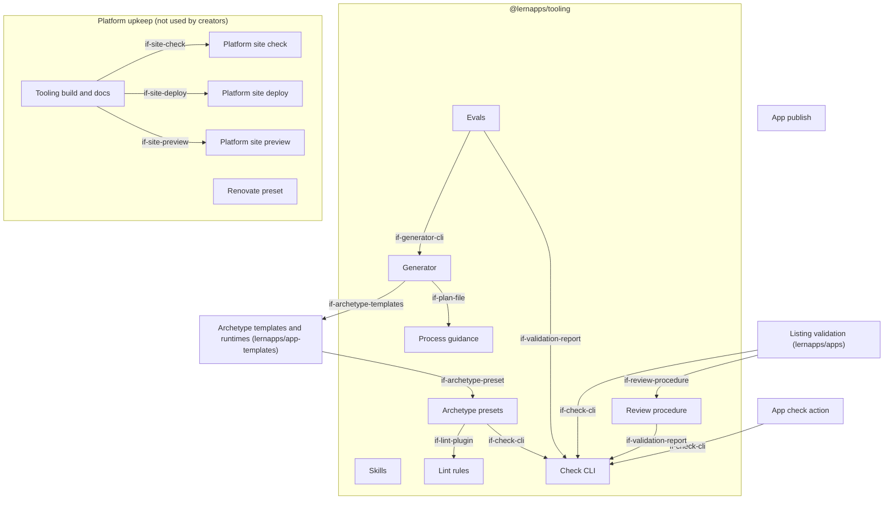
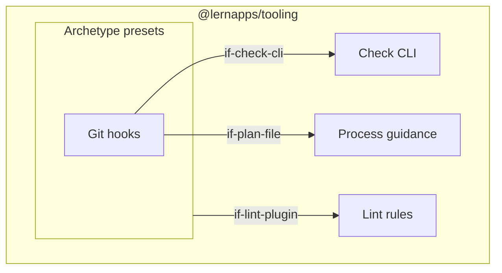

# Building Blocks

The tooling is one package, installed by apps from git at a commit and kept current by update pull requests, like
the shared site frame (decision `dec-one-package`). Next to the package, the repo holds two actions for an app's CI:
one checks the app, one publishes it. Two blocks live in other repos: the archetype templates and runtimes, and the
listing validation in the catalog. All of these make up the creator's path.

The repo also holds "Platform upkeep", which no creator uses: it builds and documents the tooling itself, checks and
publishes lernapps.net's own websites, and sets the update policy of every lernapps repo. A site, in this document,
is always one of lernapps.net's own websites, never an app.

Rules have no block of their own: each rule lives in the block where it acts, as skill text, lint rule, check or
rubric item (concept `concept-rule-catalog`).

## Level 1

```arc42
:::diagram
id: building-blocks-level-1
view: building-block
notation: mermaid
:::
```



## Level 2: archetype presets

```arc42
:::diagram
id: building-blocks-archetypes
view: building-block
notation: mermaid
roots: bb-archetypes
:::
```



## @lernapps/tooling

The one package every app depends on. It is accountable for carrying every rule, check and piece of guidance to every
app, so that an app never has to be edited to receive a change. An app holds only thin files that refer to it. The
package checks itself with the same command it gives apps, plus a test that rule ids are unique and every message
links its rule.

```arc42
:::building-block
id: bb-tooling-package
title: "@lernapps/tooling"
technology: TypeScript, npm package from git
implements: concept-stable-contracts
:::
```

### Process guidance

The workflow for the creator's assistant: four phases, Explore, Plan, Code and Commit, with the creator's
checkpoints. It decides the order of the work and when the assistant stops for the creator. It states no rule of
its own.

The plan starts with the questions for the creator, including what the catalog needs to help adults find the app,
and keeps the answers for the listing. It ends with a retrospective: phases reached, failed checks, the creator's
turns after the plan, and where the assistant had to guess. Comments in the template explain each part, so the
template itself guides the assistant.

```arc42
:::building-block
id: bb-process-guidance
title: Process guidance
parent: bb-tooling-package
technology: Markdown
implements: concept-plain-language, concept-terse-output, concept-traceability
:::
```

#### AGENTS.md

The entry point every assistant reads in the app repo. A consumer can rely on it to stay short and to point to the
plan and the skills; it holds nothing else.

```arc42
:::interface
id: if-agents-md
title: AGENTS.md
provider: bb-process-guidance
protocol: Markdown file at the app's root
:::
```

#### Plan file

The plan in the app repo, readable by the creator. It stays in the creator's repo and reaches the platform only with
a listing. A consumer can rely on two things: its front matter has a versioned schema, and its headings, the four
phases and the parts of the retrospective, are fixed. Hooks, review and evals read it by those. A breaking change gets
a new schema version.

```arc42
:::interface
id: if-plan-file
title: Plan file
provider: bb-process-guidance
protocol: Markdown with YAML front matter and a versioned JSON Schema
:::
```

### Skills

The rules as the assistant reads them, and the know-how around them: one general skill, one per archetype, topic
skills such as third-party content, and one for listing. Each skill section that states a rule names its rule id.
The skills reach the creator's agent harness for an app from the generator as for one built otherwise.

```arc42
:::building-block
id: bb-skills
title: Skills
parent: bb-tooling-package
technology: Markdown (agentskills.io)
implements: concept-rule-catalog, concept-plain-language, concept-terse-output
:::
```

#### Skills interface

A consumer can rely on one skill per concern, in the open skill format, loadable by any harness when a task needs
it. Each rule a skill states keeps its id.

```arc42
:::interface
id: if-skills
title: Skills
provider: bb-skills
protocol: Agent skills (agentskills.io)
:::
```

### Generator

Writes a new app from the archetype's template, once the creator has confirmed the plan. It is accountable for an
app that passes every check from the first commit and that depends on the exact version of the tooling it came from.
It runs before anything is installed. It does not build content; the assistant does. On request it also moves an
existing app to the runtime and tooling that a newer tooling pins, so that a fix reaches the app without waiting for
an update pull request.

```arc42
:::building-block
id: bb-generator
title: Generator
parent: bb-tooling-package
technology: TypeScript CLI
requires: if-archetype-templates, if-plan-file
implements: concept-stable-contracts
:::
```

#### Generator CLI

A consumer can rely on this: given an archetype and an empty folder, it writes a complete app and keeps a plan that
is already there. It refuses an unknown archetype and a folder that holds anything else, and says why. It can work
offline from a local copy of the templates. Given an existing app, it moves the app's pins to its own and installs
them. The commands' own help lists their options.

```arc42
:::interface
id: if-generator-cli
title: Generator CLI
provider: bb-generator
protocol: Command line, documented by its own help
:::
```

### Archetype presets

What an app imports and never edits: one preset per archetype on a shared base. A preset decides the toolchain's
configuration (lint, format, types, unit and end-to-end tests, build), the runtime helpers every app needs (texts,
accessibility, storage on the device) and the git hooks. So an app's configuration stays one line per file, and a
change to a rule or a hook reaches every app with the next version of the package.

What runs in the app beyond these helpers, the archetype's runtime, is not part of the presets. It lives with the
templates (decision `dec-runtime-package`).

```arc42
:::building-block
id: bb-archetypes
title: Archetype presets
parent: bb-tooling-package
technology: vite-plus, Playwright
requires: if-lint-plugin, if-check-cli
implements: concept-rule-catalog, concept-stable-contracts
:::
```

#### Archetype preset interface

A consumer can rely on named entry points of the package: the configuration to extend, the typed runtime helpers and
the hooks. An app passes only its own settings, which are merged over the preset.

```arc42
:::interface
id: if-archetype-preset
title: Archetype preset
provider: bb-archetypes
protocol: npm subpath exports
:::
```

#### Git hooks

Part of the preset, installed when the app's dependencies are installed, and only where the app is the root of its
repository, never into a repository the app's folder sits in; the app holds no hook of its own. The
hooks are accountable for feedback before code leaves the creator's machine: the fast part of the check before a
commit, the heavy part before a push. Together they run exactly what CI runs. A failed push is counted in the plan.

```arc42
:::building-block
id: bb-git-hooks
title: Git hooks
parent: bb-archetypes
technology: git hooks
requires: if-check-cli, if-plan-file
implements: concept-terse-output, concept-traceability
:::
```

### Lint rules

The rules that can be decided on source code: no requests to other hosts, storage only through the preset's helper,
learner texts only from the message files, a reason for every suppression, and what a component's code may do
(concept `concept-components`). They read syntax only, so they are fast enough for the editor and the commit. What
they cannot see, such as a request a built page makes or a component's template, the check or the archetype's build
finds under the same rule id.

```arc42
:::building-block
id: bb-lint-rules
title: Lint rules
parent: bb-tooling-package
technology: Oxlint JS plugin
implements: concept-rule-catalog, concept-terse-output, concept-components
:::
```

#### Lint plugin

The preset loads the plugin; apps do not configure it. A consumer can rely on every message naming its rule, the
fix and the link to the rule.

```arc42
:::interface
id: if-lint-plugin
title: Lint plugin
provider: bb-lint-rules
protocol: Oxlint / ESLint plugin API
:::
```

### Check CLI

Runs every deterministic check, from format and types to the checks of the built app in a browser. It is the same
command in the hooks, in CI and in the listing validation. It runs every check that finds something to check. The
checks of the built app need no source repo: they work on a bundle or on a
deployed address, so apps built any other way are checked the same. A page that an archetype's runtime marks as its
own also gets that archetype's checks: an explainer page is opened a second time, without JavaScript, to find what
the explainer promises there; other pages pay nothing for it. It can also check a catalog entry against the app, down
to the sections its topics link. Its output is the validation report.

```arc42
:::building-block
id: bb-check-cli
title: Check CLI
parent: bb-tooling-package
technology: TypeScript CLI, Playwright, axe-core
implements: concept-rule-catalog, concept-terse-output, concept-traceability, concept-stable-contracts
:::
```

#### Check CLI interface

A consumer can rely on this: it fails exactly when a rule of severity error fails. A passing run prints one line; a
failing one prints the report. It can always keep the full report. Its parts, its options and its exit codes are
listed in the command's own help and stay stable (concept `concept-stable-contracts`).

```arc42
:::interface
id: if-check-cli
title: Check CLI
provider: bb-check-cli
protocol: Command line, documented by its own help
:::
```

#### Validation report

The result of a check run: what was checked (a commit, or an address and a time), the rules in scope, findings per
rule id with location and fix, and the fitness values for the entry. A consumer can rely on it being deterministic,
the same input giving the same report, and on its published schema.

```arc42
:::interface
id: if-validation-report
title: Validation report
provider: bb-check-cli
protocol: YAML with a published JSON Schema
:::
```

### Review procedure

The judgment part of the validation: a prompt for an agent in a fresh context, the rubric of the rules no program
decides, and the format of the verdict. The agent starts from the validation report and does not judge again what
it decided. It judges the rest: whether learners act themselves, ads, plain language, data about learners, what
happens after a click. A guess in the retrospective, or a problem no rule covers, becomes a proposed rule. The
procedure decides nothing about the listing; the owner does.

```arc42
:::building-block
id: bb-review-procedure
title: Review procedure
parent: bb-tooling-package
technology: Markdown, JSON Schema
requires: if-validation-report
implements: concept-rule-catalog, concept-plain-language, concept-terse-output, concept-traceability, concept-stable-contracts
:::
```

#### Review procedure interface

The owner gives the prompt to a fresh agent with the app and the commit to review. A consumer can rely on a rubric
for every app and one per archetype, every item headed by its rule id.

```arc42
:::interface
id: if-review-procedure
title: Review procedure
provider: bb-review-procedure
protocol: Prompt and rubric, read by an agent
:::
```

#### Review verdict

The result of a review: the reviewed commit, the report it started from, the rubric items judged, and per finding
the rule id, or a proposed new rule and where it would act. A consumer can rely on a verdict that has passed its
check against the published schema and the rule catalog before the owner sees it.

```arc42
:::interface
id: if-review-verdict
title: Review verdict
provider: bb-review-procedure
protocol: YAML with a published JSON Schema
:::
```

### Evals

Sample creator prompts, at least one per archetype, with the expected result. They test the guidance itself before
a change to it is merged. They are run by hand with several assistants and scored by the check, the review and the
plan's counters.

```arc42
:::building-block
id: bb-evals
title: Evals
parent: bb-tooling-package
technology: Markdown prompts
requires: if-generator-cli, if-check-cli, if-validation-report, if-review-procedure
implements: concept-traceability
:::
```

## Archetype templates and runtimes

One template per archetype, each a working app that passes every check and can be tried on its own, and the runtime
the apps of an archetype share. A template holds only thin files and example content. The runtime holds what runs in
the app. It is accountable for an archetype's promise holding by construction, from the content alone:
- for the quiz, it renders every question into the page, so the page reads without a script, and runs the quiz in
  the browser with feedback after each answer;
- for the explainer, it renders every page of the content at build, readable without a script and in each of the
  app's languages; it brings the exercises to life in the browser, the quiz's question types among them, and checks
  and hydrates the app's own components (concept `concept-components`).

Their own tests run in their repo.

```arc42
:::building-block
id: bb-app-templates
title: Archetype templates and runtimes
technology: TypeScript, Vite plugin, Vue, Playwright
requires: if-archetype-preset
implements: concept-components
:::
```

### Archetype templates interface

The generator copies one template at the commit the package pins. A consumer can rely on templates, runtimes and
presets changing together.

```arc42
:::interface
id: if-archetype-templates
title: Archetype templates
provider: bb-app-templates
protocol: Files at a pinned commit
:::
```

### Archetype runtime

What an app depends on at runtime, installed at the commit its template came from and moved forward by update pull
requests. A consumer can rely on one entry point per archetype; it ships no templates.

```arc42
:::interface
id: if-archetype-runtime
title: Archetype runtime
provider: bb-app-templates
protocol: npm package from git, subpath exports per archetype
:::
```

### Question bank

The content a quiz is made of: questions of several types, each with an explanation and links for further reading,
and background knowledge for every option. A consumer can rely on a published schema; the build fails with one
message per problem. New question types extend the schema without changing the existing ones.

```arc42
:::interface
id: if-question-bank
title: Question bank
provider: bb-app-templates
protocol: JSON with a published JSON Schema
:::
```

### Explainer content

The content an explainer is made of: chapters of pages, each a list of blocks from a closed set with an exercise,
data files, bundled images, and components where no block fits. A consumer can rely on a published schema that
refers to the question bank's for the quiz's question types, and on the build failing with one line per problem, its
file and place. New blocks extend the schema without changing the existing ones.

```arc42
:::interface
id: if-explainer-content
title: Explainer content
provider: bb-app-templates
protocol: YAML with a published JSON Schema; Vue single-file components
:::
```

## App check action

Runs in an app's CI exactly what the app's git hooks ran, nothing more. It only sets up the environment around the
check, and keeps the report, passing or not. On the main line it also keeps the bundle it checked, so the app
publishes what was checked and builds it once (decision `dec-app-own-hosting`).

```arc42
:::building-block
id: bb-app-check-action
title: App check action
technology: GitHub composite action
path: actions/app-check
requires: if-check-cli
:::
```

### App check action interface

A consumer can rely on the same result as the hooks, the report kept with every run, and on the main line the
checked bundle for the app publish action. Its inputs are described in the action itself.

```arc42
:::interface
id: if-app-check-action
title: App check action
provider: bb-app-check-action
protocol: GitHub Actions, pinned to a commit
:::
```

## App publish

Publishes an app's checked bundle to the GitHub Pages of the app's repo, at the developer's own address. It is the
simple default: the app lives at its developer's hosting, which may be any other host, and lernapps.net only links to
it (decision `dec-app-own-hosting`). It is accountable for a
setup that later previews of pull requests can share. Before the deploy it checks that setup and fixes it where it
may; where it may not, it fails with a message for the creator's assistant that says what to change and why.

```arc42
:::building-block
id: bb-app-publish
title: App publish
technology: GitHub composite action, GitHub Pages
path: actions/app-publish
:::
```

### App publish interface

A consumer can rely on this: when the action passes, the app's address serves the new bundle, and the action names
the address. Its inputs, outputs and the permissions it needs are described in the action itself.

```arc42
:::interface
id: if-app-publish
title: App publish
provider: bb-app-publish
protocol: GitHub Actions, pinned to a commit
:::
```

## Listing validation

Runs on pull requests to the catalog that add or change an entry. It runs the checks of the built app against the
entry's address, so it also confirms that the entry's topic links resolve and its fitness values match. When checks
fail, it hands the report to the creator's assistant. The review agent then judges the rest; the owner decides.

```arc42
:::building-block
id: bb-listing-validation
title: Listing validation
technology: GitHub Actions workflow
requires: if-check-cli, if-review-procedure, if-validation-report
implements: concept-terse-output, concept-traceability
:::
```

### Listing results comment

The validation report on the pull request. A consumer, the creator's assistant, can rely on it holding enough to fix
the app and push again.

```arc42
:::interface
id: if-listing-comment
title: Listing results comment
provider: bb-listing-validation
protocol: Pull request comment
:::
```

## Platform upkeep

What keeps lernapps.net's own websites and repos in shape. No creator uses it, and nothing on the creator's path
depends on it. It is accountable for the tooling's own documentation and for every website of lernapps.net behaving the
same. Its platform site actions, used only for lernapps.net's own websites and never for an app, build and check a
site, publish it, and preview a pull request.

```arc42
:::building-block
id: bb-platform-upkeep
title: Platform upkeep (not used by creators)
:::
```

### Tooling build and docs

Builds and checks the tooling itself and publishes its documentation: the architecture, the rule catalog, read from
the artifacts where the rules live, and the published schemas.

```arc42
:::building-block
id: bb-tooling-build
title: Tooling build and docs
parent: bb-platform-upkeep
technology: shell script, arc42
requires: if-site-check, if-site-deploy, if-site-preview
:::
```

#### Tooling documentation

A consumer can rely on the tooling's documentation, rule catalog and schemas at stable addresses on lernapps.net.
Every check message links its rule there.

```arc42
:::interface
id: if-tooling-docs
title: Tooling documentation
provider: bb-tooling-build
protocol: Website on lernapps.net
:::
```

### Platform site check

Builds a site and checks the build, the same way for every site. On the main line it keeps the build for the deploy.

```arc42
:::building-block
id: bb-site-check
title: Platform site check
parent: bb-platform-upkeep
technology: GitHub composite action
path: actions/site-check
:::
```

#### Platform site check interface

A consumer can rely on one contract with the site's repo: an install, a build that writes the static site, and a
check of it.

```arc42
:::interface
id: if-site-check
title: Platform site check
provider: bb-site-check
protocol: GitHub Actions, pinned to a commit
:::
```

### Platform site deploy

Publishes the checked build of a site to the GitHub Pages of its repo in the lernapps organisation, below
lernapps.net.

```arc42
:::building-block
id: bb-site-deploy
title: Platform site deploy
parent: bb-platform-upkeep
technology: GitHub composite action
path: actions/site-deploy
:::
```

#### Platform site deploy interface

A consumer can rely on the checked build being served as the repo's website on lernapps.net, with previews left in
place.

```arc42
:::interface
id: if-site-deploy
title: Platform site deploy
provider: bb-site-deploy
protocol: GitHub Actions, pinned to a commit
:::
```

### Platform site preview

Builds a pull request like the site check and publishes it next to the site, for review.

```arc42
:::building-block
id: bb-site-preview
title: Platform site preview
parent: bb-platform-upkeep
technology: GitHub composite action
path: actions/site-preview
:::
```

#### Platform site preview interface

A consumer can rely on a preview of each pull request's build on lernapps.net, removed when the pull request closes.

```arc42
:::interface
id: if-site-preview
title: Platform site preview
provider: bb-site-preview
protocol: GitHub Actions, pinned to a commit
:::
```

### Renovate preset

The update policy of every lernapps repo, apps from the generator included: which updates merge on their own and
when. The platform's own building blocks follow their main line at once.

```arc42
:::building-block
id: bb-renovate-preset
title: Renovate preset
parent: bb-platform-upkeep
technology: Renovate preset
:::
```

#### Update policy

A consumer can rely on one shared policy: a repo extends it and needs no policy of its own.

```arc42
:::interface
id: if-update-policy
title: Update policy
provider: bb-renovate-preset
protocol: Renovate shareable preset
:::
```
