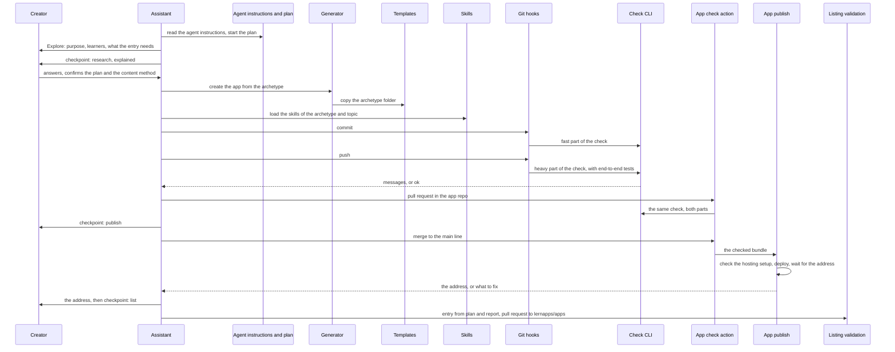
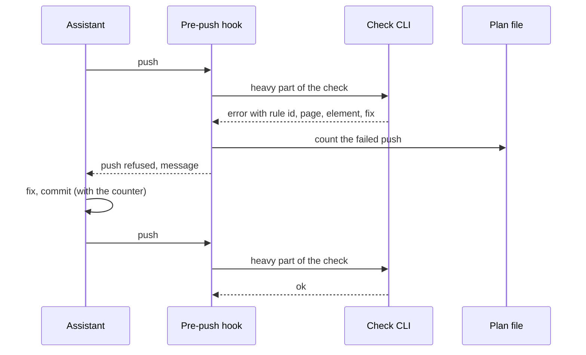
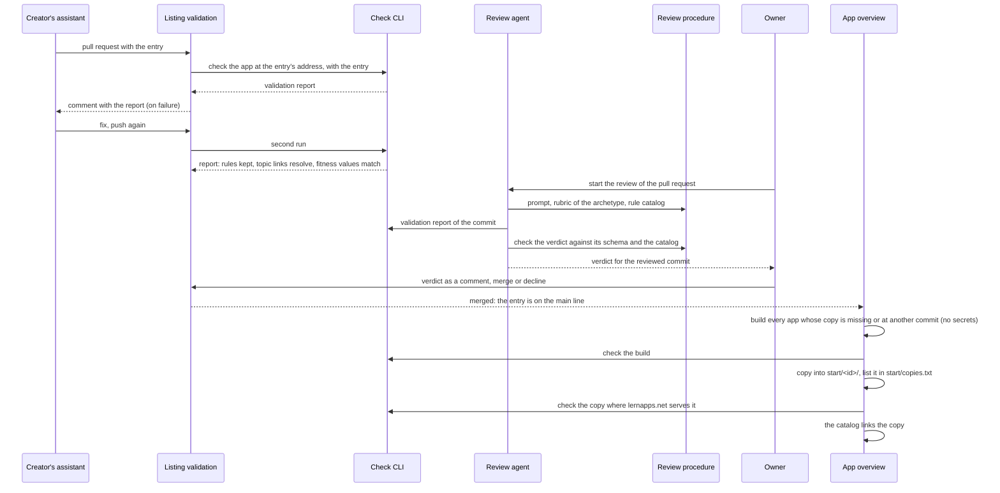
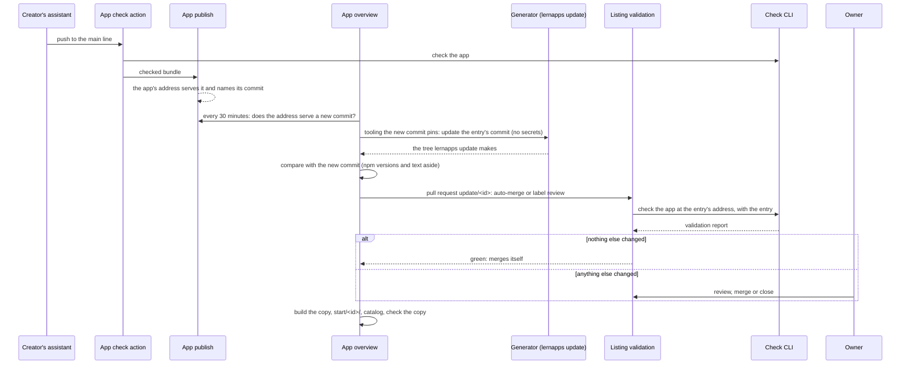
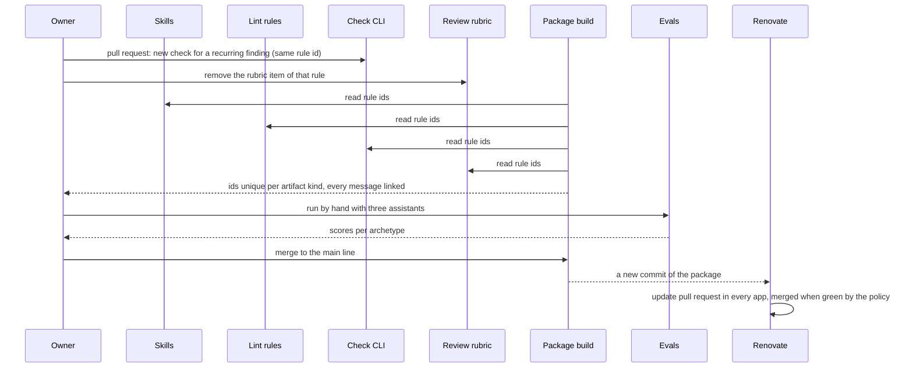

# Runtime View

Four scenarios show how the building blocks work together: a new app from first prompt to listing pull request, a
failing push, the validation of a listing, and a rule that changes.

## A new app, from first prompt to listing

The creator asks their assistant for an app. The assistant reads the agent instructions, explores the idea with the
creator in the plan, including what the entry needs to help adults find the app, and the creator confirms the plan.
Then the assistant works on its own: it creates the app from the archetype, builds it with the skills and the hooks'
feedback, and publishes it. Once the change reaches the main line, the app publish action puts the checked bundle on
the app's hosting and names the address. Then the assistant lists the app from the plan and the validation report.

```arc42
:::runtime-scenario
id: rs-new-app
title: A new app, from first prompt to listing
trigger: A creator asks their AI assistant for a learning app
involves: bb-process-guidance, bb-generator, bb-app-templates, bb-skills, bb-archetypes, bb-lint-rules, bb-git-hooks, bb-check-cli, bb-app-check-action, bb-app-publish, bb-listing-validation
:::
```

```arc42
:::diagram
id: rs-new-app-sequence
scenario: rs-new-app
notation: mermaid-sequence
aliases: creator=actor-creator, assistant=actor-assistant, guidance=bb-process-guidance, generator=bb-generator, templates=bb-app-templates, skills=bb-skills, hooks=bb-git-hooks, check=bb-check-cli, ci=bb-app-check-action, publish=bb-app-publish, listing=bb-listing-validation
:::
```



## A push fails

The check before a push finds a request to another server in a built page. The hook prints the message and counts
the failure in the plan. The assistant fixes the app without asking the creator.

```arc42
:::runtime-scenario
id: rs-push-fails
title: A push fails
trigger: The assistant pushes a commit that breaks a checked rule
involves: bb-git-hooks, bb-check-cli, bb-process-guidance
:::
```

```arc42
:::diagram
id: rs-push-fails-sequence
scenario: rs-push-fails
notation: mermaid-sequence
aliases: assistant=actor-assistant, hooks=bb-git-hooks, check=bb-check-cli, plan=bb-process-guidance
:::
```



## A listing is validated

A pull request adds an entry to lernapps/apps. The listing validation checks the deployed app against the entry:
the rules, the topic links, the fitness values. On failure it comments the report; the creator's assistant fixes the
app or the entry and pushes again. Then the owner starts the review agent in a fresh context: it judges the rest
against the rubric of the app's archetype and writes a verdict for the reviewed commit, which the owner posts on the
pull request before deciding. Proposed rules from the verdict go to the tooling as new pull requests. After the
merge, the app overview builds the copy from the entry's commit, checks it, puts it into `start/<id>/` and links it
in the catalog once it is served (decision `dec-copies-served`).

```arc42
:::runtime-scenario
id: rs-listing-validated
title: A listing is validated
trigger: A pull request to lernapps/apps adds or changes an entry
involves: bb-listing-validation, bb-check-cli, bb-review-procedure
:::
```

```arc42
:::diagram
id: rs-listing-validated-sequence
scenario: rs-listing-validated
notation: mermaid-sequence
aliases: assistant=actor-assistant, listing=bb-listing-validation, check=bb-check-cli, review=actor-review-agent, procedure=bb-review-procedure, owner=actor-owner, overview=actor-app-overview
:::
```



## A new version of a listed app reaches its copy

The creator, their assistant or an update pull request of the tooling changes a listed app on its main line. The app
publish action deploys it to the app's own address, which then names the new commit. The app overview notices it
within 30 minutes, opens an update pull request for the entry and classifies it: it replays `lernapps update` with
the tooling the new commit pins on the entry's commit and compares (decision `dec-update-replay`). The listing
validation runs on the pull request as on a new listing. A routine update merges itself; any other change waits for
the owner. The merge publishes the copy as after a listing.

```arc42
:::runtime-scenario
id: rs-new-version
title: A new version of a listed app reaches its copy
trigger: A push to the main line of a listed app's repo
involves: bb-app-check-action, bb-app-publish, bb-generator, bb-listing-validation, bb-check-cli
:::
```

```arc42
:::diagram
id: rs-new-version-sequence
scenario: rs-new-version
notation: mermaid-sequence
aliases: assistant=actor-assistant, appcheck=bb-app-check-action, publish=bb-app-publish, overview=actor-app-overview, generator=bb-generator, listing=bb-listing-validation, check=bb-check-cli, owner=actor-owner
:::
```



## A rule changes

The owner tightens a rule, or a creator contributes one. The pull request changes the artifact where the rule acts:
the skill text, the lint rule, the check or the rubric item, keeping or adding the rule id. The tooling's own check
tests the ids; the evals run; after the merge, an update pull request brings the change to every app.

```arc42
:::runtime-scenario
id: rs-rule-changes
title: A rule changes
trigger: A pull request to lernapps/tooling changes a rule in its artifact
involves: bb-tooling-package, bb-skills, bb-lint-rules, bb-check-cli, bb-review-procedure, bb-evals
:::
```

```arc42
:::diagram
id: rs-rule-changes-sequence
scenario: rs-rule-changes
notation: mermaid-sequence
aliases: owner=actor-owner, package=bb-tooling-package, skills=bb-skills, lint=bb-lint-rules, check=bb-check-cli, procedure=bb-review-procedure, evals=bb-evals, github=actor-renovate
:::
```


