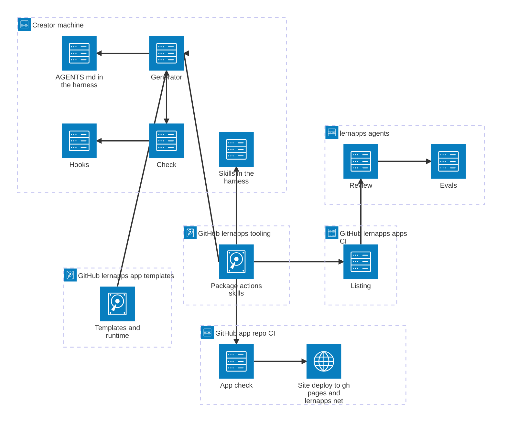

# Deployment View

The tooling has no server of its own. Its parts are files in git repos on GitHub. They reach the places where they
run as git commits: npm installs them from git, the generator fetches them with git, a workflow names an action by
its commit. Renovate moves those commits forward. This chapter says, per node, what arrives there, from where and how,
and where the app goes in the end. What each part does is in chapter 5.

## Deployment overview

The arrows show where the parts go: from the repos on GitHub to the creator's machine and its harness, to the CI of
the repos and to the environment for lernapps agents. The app goes from its repo's CI to lernapps.net, and a listing
from the catalog's CI to the review.

```arc42
:::diagram
id: deployment-overview
view: deployment
notation: mermaid-architecture
aliases: creator=dn-creator-machine, agents=dn-lernapps-agents, toolingrepo=dn-tooling-repo, templaterepo=dn-templates-repo, appci=dn-app-ci, appsci=dn-apps-ci, generator=bb-generator, hooks=bb-git-hooks, checklocal=bb-check-cli, skills=bb-skills, guidance=bb-process-guidance, package=bb-tooling-package, templates=bb-app-templates, appcheck=bb-app-check-action, publish=bb-publishing-actions, listing=bb-listing-validation, review=bb-review-procedure, evals=bb-evals
:::
```



## Creator's machine

The creator's computer or their assistant's sandbox. Nothing of the tooling is installed there at first, and
nothing is installed globally. The parts arrive in this order:
- **The generator**, once: `npx --yes github:lernapps/tooling#main create --archetype <archetype>`, the command in
  the plan template's Code tasks (block "Generator"). npm resolves `main` to a commit, fetches the package from
  GitHub and runs its `prepare`, which builds the CLI.
- **The template:** the generator fetches the archetype's folder with git from lernapps/app-templates, at the commit
  pinned in the package.
- **The package and the runtime:** `npm install` in the new app installs `@lernapps/tooling` from git at the commit the
  generator came from, and the runtime `@lernapps/app-templates` from git at the template's commit. The other
  dependencies come from the npm registry. The app's `prepare` installs the git hooks from the package.
- **The browser:** the first check that needs one downloads Playwright's browser and caches it. The check says
  clearly when a sandbox cannot run one.

From then on, everything runs from the app's own `node_modules`: `npx lernapps check` and the hooks. The machine
needs git, Node and access to github.com, codeload.github.com and the npm registry. If the sandbox blocks them, the
creator allows them; the assistant does not write the app by hand.

```arc42
:::deployment-node
id: dn-creator-machine
title: Creator's machine or assistant sandbox
type: device
hosts: bb-tooling-package, bb-generator, bb-archetypes, bb-git-hooks, bb-lint-rules, bb-check-cli
:::
```

### Creator's agent harness

The runtime of the creator's assistant: Claude Code, Codex, Gemini CLI or another agent. Two things arrive here:
- `AGENTS.md`, written by the generator at the app's root, which every harness reads. Before the app exists, the
  assistant starts the plan from the template on GitHub; <https://lernapps.net/llms.txt> points to it.
- the skills: `npx skills add lernapps/tooling` copies them from GitHub into the harness's skill folder (e.g.
  `.agents/skills/`, `.claude/skills/`). Running it again brings newer skills.

The harness decides when to load a skill. Hooks of the harness itself may add convenience but enforce nothing.

```arc42
:::deployment-node
id: dn-agent-harness
title: Creator's agent harness
type: environment
parent: dn-creator-machine
hosts: bb-process-guidance, bb-skills
:::
```

## Environment for lernapps agents

Where agents defined by lernapps run: the review agent on a listing pull request, and the eval runs. Today it is the
owner's machine. It receives a checkout of lernapps/tooling at `main`, with `npm ci`. For a review, the agent clones
the app at the commit to review into a directory of its own (`.reviews/`, ignored by git). Only the verdict leaves the
environment: the owner posts it on the listing pull request.

```arc42
:::deployment-node
id: dn-lernapps-agents
title: Environment for lernapps agents
type: environment
hosts: bb-tooling-package, bb-review-procedure, bb-evals, bb-check-cli
:::
```

## GitHub

The means of production (`con-github`): every part comes from a repo here, and every app and site is served from
here.

```arc42
:::deployment-node
id: dn-github
title: GitHub
type: cloud-region
:::
```

### lernapps/tooling

The source of the package, the actions and the skills. Each consumer takes them at a commit:
- npx and npm install the package from git;
- a workflow names an action by its commit (`uses: lernapps/tooling/actions/<name>@<commit>`);
- `npx skills add` copies the skills.

The repo's own site, at lernapps.net/tooling/, publishes the documentation, the rule catalog and the schemas.

```arc42
:::deployment-node
id: dn-tooling-repo
title: lernapps/tooling repository
type: environment
parent: dn-github
hosts: bb-tooling-package, bb-app-check-action, bb-publishing-actions
:::
```

### lernapps/app-templates

The template folders, which the generator fetches at the commit pinned in the package, and the runtime package at
the root, which every app installs from git at the commit of its template.

```arc42
:::deployment-node
id: dn-templates-repo
title: lernapps/app-templates repository
type: environment
parent: dn-github
hosts: bb-app-templates
:::
```

### App repo CI

GitHub Actions of each app repo, with the workflow `pages.yml` the generator wrote. It names the app check action
and the site deploy action at the commit of the package the app was created with. The app check action installs the
app's dependencies with `npm ci`, as on the creator's machine, and runs the same check as the hooks. On `main`, the
site deploy action pushes the checked bundle to the app repo's `gh-pages` branch.

```arc42
:::deployment-node
id: dn-app-ci
title: App repo CI (GitHub Actions)
type: container
parent: dn-github
hosts: bb-app-check-action, bb-publishing-actions, bb-check-cli
:::
```

### lernapps/apps CI

GitHub Actions of the catalog: the listing validation on pull requests that add or change an entry. It installs the
package from git at a commit. When the owner merges the listing, the catalog's own workflow publishes it at
lernapps.net/apps/, and the entry links to the app.

```arc42
:::deployment-node
id: dn-apps-ci
title: lernapps/apps CI (GitHub Actions)
type: container
parent: dn-github
hosts: bb-listing-validation, bb-check-cli
:::
```

### lernapps.net

GitHub Pages serves the `gh-pages` branch of each lernapps repo at lernapps.net/<repo>/. The site deploy action
writes that branch from the repo's own workflow. So an app's bundle goes from its repo's CI to the app repo's
`gh-pages` branch and is served at lernapps.net/<repo>/; the catalog entry in lernapps/apps links there. An app
hosted elsewhere is published by its creator; its entry links to that address.

```arc42
:::deployment-node
id: dn-lernapps-net
title: lernapps.net (GitHub Pages)
type: environment
parent: dn-github
:::
```

## How updates arrive

Every app repo has the Renovate preset of lernapps (`renovate.json`, written by the generator). Renovate proposes a
pull request when a newer commit exists:
- of `@lernapps/tooling`, which brings new rules, checks, hooks and guidance;
- of `@lernapps/app-templates`, which brings new features of the archetype's runtime;
- of the actions named in `pages.yml`.

The app check action runs on that pull request, and the preset says when it merges (README, "Renovate preset"). The
generator's pin of app-templates moves by hand in lernapps/tooling; an app created before keeps its template files
and gets the runtime by Renovate. The skills in the harness update when `npx skills add` runs again.
