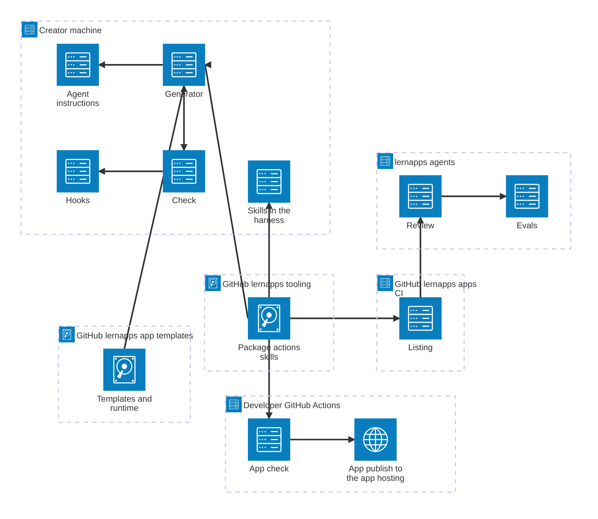

# Deployment View

The tooling has no server of its own. Its parts are files in git repos on GitHub, and they reach the places where
they run as git commits. Update pull requests move those commits forward. This chapter says, per node, what it
receives and what it hosts; what each part does is in chapter 5. lernapps.net hosts nothing of an app: the app lives
at its developer's hosting, and the catalog links to it (decision `dec-app-own-hosting`).

## Deployment overview

The arrows show where the parts go: from the repos on GitHub to the creator's machine, to the CI of the repos and to
the environment for lernapps agents. The app's CI checks the app and publishes it to the app's hosting. A listing goes
from the catalog's CI to the review.

```arc42
:::diagram
id: deployment-overview
view: deployment
notation: mermaid-architecture
aliases: creator=dn-creator-machine, agents=dn-lernapps-agents, toolingrepo=dn-tooling-repo, templaterepo=dn-templates-repo, appci=dn-app-ci, appsci=dn-apps-ci, generator=bb-generator, hooks=bb-git-hooks, checklocal=bb-check-cli, skills=bb-skills, guidance=bb-process-guidance, package=bb-tooling-package, templates=bb-app-templates, appcheck=bb-app-check-action, publish=bb-app-publish, listing=bb-listing-validation, review=bb-review-procedure, evals=bb-evals
:::
```



## Creator's machine

The creator's computer or their assistant's sandbox. Nothing of the tooling is installed there at first, and
nothing globally. It receives, in this order: the generator (block "Generator"), the archetype's template, then the
package and the runtime as the app's dependencies, with the git hooks. The first check that needs a browser fetches
one and keeps it.

From then on, the check, the lint rules and the hooks run from the app's own dependencies. The machine needs git, Node
and network access to GitHub and the npm registry. If a sandbox blocks them, the creator allows them; the assistant
does not write the app by hand.

```arc42
:::deployment-node
id: dn-creator-machine
title: Creator's machine or assistant sandbox
type: device
hosts: bb-tooling-package, bb-generator, bb-archetypes, bb-git-hooks, bb-lint-rules, bb-check-cli, bb-app-templates
:::
```

### Creator's agent harness

The runtime of the creator's assistant, whichever it is. It receives the agent instructions, which the generator
writes into the app, and the skills, copied from GitHub into the harness and refreshed the same way. Before the app
exists, the assistant starts the plan from the published template. The harness decides when to load a skill; its own
hooks may add convenience but enforce nothing.

```arc42
:::deployment-node
id: dn-agent-harness
title: Creator's agent harness, with AGENTS.md and the skill folder
type: environment
parent: dn-creator-machine
hosts: bb-process-guidance, bb-skills
:::
```

## Environment for lernapps agents

Where agents defined by lernapps run: the review agent on a listing, and the evals. Today it is the owner's machine.
It receives a checkout of the tooling at its main line. For a review, it receives the app at the commit to review.
Only the verdict leaves this environment: the owner posts it on the listing.

```arc42
:::deployment-node
id: dn-lernapps-agents
title: Environment for lernapps agents
type: environment
hosts: bb-tooling-package, bb-generator, bb-review-procedure, bb-evals, bb-check-cli
:::
```

## GitHub

The means of production (`con-github`): every part comes from a repo here, and every app and site is served from
here by default.

```arc42
:::deployment-node
id: dn-github
title: GitHub
type: cloud-region
:::
```

### lernapps/tooling

The source of the package, the actions and the skills. Every consumer takes them at a commit: the package as a
dependency, the actions by name in a workflow, the skills by copying them. The repo's own site on lernapps.net
publishes the documentation, the rule catalog and the schemas, with the site actions (block "Site actions").

```arc42
:::deployment-node
id: dn-tooling-repo
title: lernapps/tooling repository
type: environment
parent: dn-github
hosts: bb-tooling-package, bb-app-check-action, bb-app-publish, bb-site-actions
:::
```

### lernapps/app-templates

Hosts the templates, which the generator fetches at the commit the package pins, and the runtime, which every app
installs at the commit of its template.

```arc42
:::deployment-node
id: dn-templates-repo
title: lernapps/app-templates repository
type: environment
parent: dn-github
hosts: bb-app-templates
:::
```

### Developer's GitHub Actions

The CI of the app repo, which belongs to the developer. It receives the app check action and the app publish action,
named in the workflow the generator wrote, at the commit of the package the app was created with. On every change it
runs the same check as the hooks. On the main line it publishes the checked bundle to the app's hosting.

```arc42
:::deployment-node
id: dn-app-ci
title: Developer's GitHub Actions (app repo CI)
type: container
parent: dn-github
hosts: bb-app-check-action, bb-app-publish, bb-check-cli
:::
```

### lernapps/apps CI

The CI of the catalog. It receives the package at a commit and runs the listing validation on every pull request that
adds or changes an entry. When the owner merges a listing, the catalog publishes it, and the entry links to the app.

```arc42
:::deployment-node
id: dn-apps-ci
title: lernapps/apps CI (GitHub Actions)
type: container
parent: dn-github
hosts: bb-listing-validation, bb-check-cli
:::
```

### The app's hosting

Where the app is served: the developer's choice. By default it is the app repo's own GitHub Pages, which receives
the checked bundle from the app publish action. An app repo of the lernapps organisation is served below
lernapps.net; a repo elsewhere at its owner's address. Nothing of the tooling runs here.

```arc42
:::deployment-node
id: dn-app-hosting
title: The app's hosting (default the app repo's GitHub Pages)
type: environment
:::
```

## How updates arrive

Every app repo receives the organisation's update policy from the generator. An update pull request arrives when the
package, the runtime or the actions have a newer commit. The app check action runs on it, and the policy decides when
it merges. The template an app was created from does not change afterwards; new features reach the app through the
runtime. The skills in the harness change when they are copied again.
